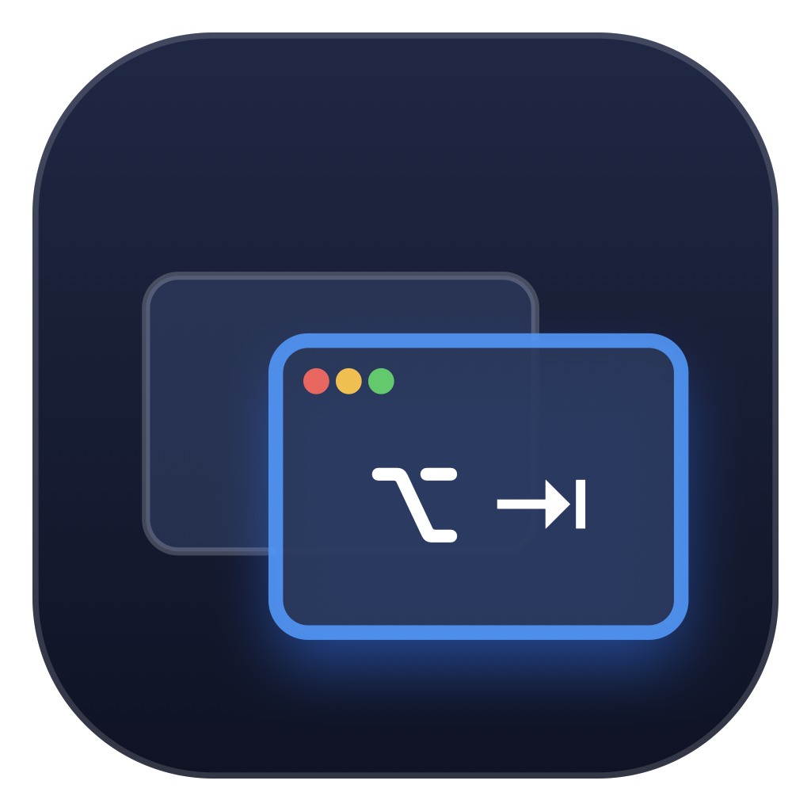
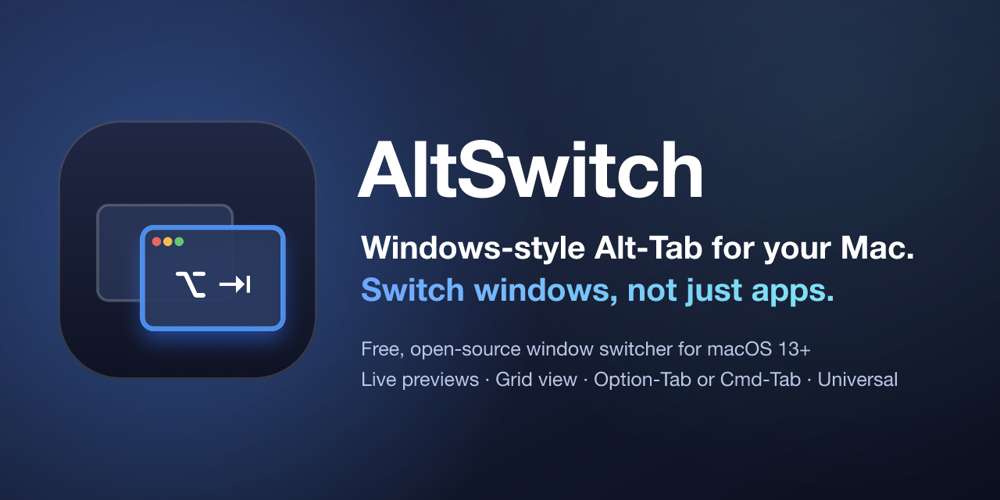

<!-- SPDX-License-Identifier: MIT -->
[English](README.md) · **Deutsch**

<div align="center">



# AltSwitch

**Alt-Tab wie unter Windows – für deinen Mac: Wechsle Fenster, nicht nur Programme.**

[](https://github.com/brokoskokoli/altswitch/actions/workflows/ci.yml)
[](https://github.com/brokoskokoli/altswitch/releases)
[](LICENSE)
[](#installation)
[](#installation)
[](https://github.com/brokoskokoli/homebrew-tap)



[](https://github.com/brokoskokoli/altswitch/releases/latest)

</div>

## Warum AltSwitch?

Auf dem Mac wechselt `⌘-Tab` zwischen **Programmen**. Sind drei Browserfenster, zwei Dokumente und
ein paar Terminals offen, landet man in Mission Control oder drückt `⌘-<`, bis das richtige Fenster
auftaucht.

AltSwitch funktioniert wie Alt-Tab unter Windows: **Jedes Fenster jedes Programms ist eine eigene
Karte mit Live-Vorschau**, in der Reihenfolge der letzten Nutzung. Modifier halten, Tab tippen,
loslassen – und du bist im gewünschten Fenster.

## Funktionen

- **Jedes Fenster statt jedes Programms** – jedes offene Fenster bekommt eine eigene Karte mit
  App-Icon, Titel und Live-Vorschau.
- **Zuletzt benutzt zuerst** – der erste Tab wählt das Fenster, das du vor dem aktuellen benutzt hast.
- **Drei Layouts** – ein kompaktes Karussell für den schnellen Wechsel, ein Raster aller
  Fenster (wie die Task View unter Windows) mit Pfeiltasten in beide Richtungen oder eine Liste
  nach App gruppiert, mit den vollständigen Fenstertiteln (z. B. `file.swift — project`,
  `user@host: ~/project — zsh`). `G` im Umschalter wechselt zwischen Karten und Liste.
- **Dein Kurzbefehl** – `⌥-Tab` (Option-Tab) oder `⌘-Tab` (ersetzt den Programmumschalter),
  einstellbar im Menü.
- **Tastatur oder Maus** – `⇧-Tab` oder kurz Shift antippen geht zurück, `Esc` bricht ab, ein
  einzelner Klick aktiviert eine Karte.
- **Jedes Fenster** – auch minimierte (mit Badge markiert, beim Auswählen wiederhergestellt),
  Fenster auf anderen Schreibtischen (Spaces) oder im Vollbild und Fenster ausgeblendeter Apps.
- **25 Sprachen** – folgt der macOS-Sprache oder der im Menü gewählten (Sprache).
- **Menüleisten-App** – kein Dock-Icon, ein Einrichtungsassistent für die macOS-Berechtigungen,
  auf Wunsch Start beim Anmelden.
- **Nativ und schlank** – Swift, AppKit und SwiftUI, kein Electron.
- **Privat** – überhaupt keine Netzverbindungen, keine Telemetrie, kein Konto.
- **Kostenlos und Open Source** – MIT-Lizenz.

## Installation

Voraussetzungen: **macOS 13 Ventura oder neuer**, Apple Silicon oder Intel (Universal-App).

- **Homebrew:**

  ```sh
  brew install --cask brokoskokoli/tap/altswitch
  ```

  Updates: `brew upgrade --cask altswitch`.

- **Download:** `AltSwitch-<version>.dmg` aus der
  [neuesten Version](https://github.com/brokoskokoli/altswitch/releases/latest) laden, öffnen und
  AltSwitch in *Programme* ziehen. Die Releases sind mit einer Developer ID signiert und von Apple
  notarisiert.

Beim ersten Start fragt der Einrichtungsassistent nach zwei Berechtigungen unter
*Systemeinstellungen → Datenschutz & Sicherheit*:

| Berechtigung | Wozu | Nötig |
|---|---|---|
| **Bedienungshilfen** | Kurzbefehl abfangen, gewähltes Fenster fokussieren und nach vorne holen | ja |
| **Bildschirmaufnahme** | Fenstervorschau auf den Karten | nein – ohne sie zeigen die Karten das App-Icon |

**Deinstallieren:** AltSwitch über die Menüleiste beenden und aus *Programme* löschen
(`brew uninstall --cask --zap altswitch` entfernt auch die Einstellungen).

## Tastaturkürzel

| Aktion | Tasten |
|---|---|
| Umschalter öffnen, nächstes Fenster | `⌥-Tab` oder `⌘-Tab` |
| Weiter / zurück | `Tab` / `⇧-Tab` oder `⇧` antippen |
| Im Karussell oder Raster bewegen | `←` `→` `↑` `↓` |
| Gruppierte Liste: Zeile zurück / weiter, App zurück / weiter | `↑` `↓`, `←` `→` |
| Karten ⇄ gruppierte Liste | `G` (bei offenem Umschalter) |
| Zum gewählten Fenster wechseln | Modifier loslassen, `Return` oder `Leertaste` |
| Per Maus wechseln | Karte anklicken |
| Abbrechen | `Esc` |

## Aus dem Quellcode bauen

Benötigt die Xcode Command Line Tools (`xcode-select --install`).

```sh
git clone https://github.com/brokoskokoli/altswitch.git
cd altswitch
./build.sh                 # Universal-Build → .build/AltSwitch.app
open .build/AltSwitch.app
```

`ARCHS=arm64 ./build.sh` baut nur für Apple Silicon (schneller). Lokale Builds sind ad hoc
signiert; macOS fragt für so einen Build die Berechtigungen erneut ab.

## Datenschutz

AltSwitch baut **keine Netzverbindungen** auf – keine Update-Prüfung, keine Analyse, kein
Absturzbericht. Fenstervorschauen bleiben im Arbeitsspeicher und werden nie auf die Festplatte
geschrieben. Gespeichert werden nur deine Einstellungen in
`~/Library/Preferences/com.stefanrichter.altswitch.plist`. Details auf der
[Datenschutzseite](https://brokoskokoli.github.io/altswitch/de/privacy.html).

## Mitmachen

Fehlerberichte, Ideen und Pull Requests sind willkommen – siehe [CONTRIBUTING.md](CONTRIBUTING.md)
und den [Verhaltenskodex](CODE_OF_CONDUCT.md). Sicherheitslücken bitte vertraulich melden, wie in
[SECURITY.md](SECURITY.md) beschrieben. Änderungen stehen im [CHANGELOG.md](CHANGELOG.md), der
Release-Ablauf in [docs/RELEASING.md](docs/RELEASING.md).

## Lizenz

[MIT](LICENSE) © 2026 brokoskokoli und Mitwirkende.
